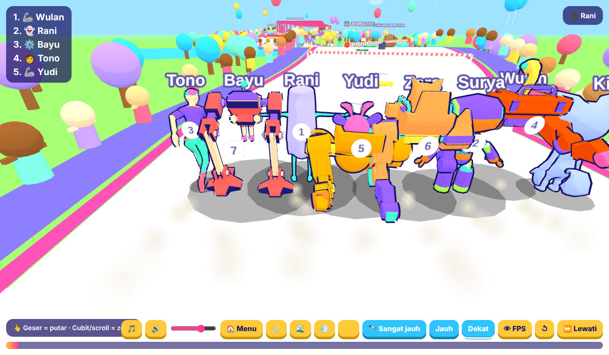

# QHA Rush!

Game lari berhadiah berbasis browser (Three.js) dengan karakter 3D beranimasi dan
tema bertema Indonesia. Seluruh game ada dalam satu file `index.html` tanpa
dependensi eksternal, sehingga bisa langsung dijalankan.



## Menjalankan secara lokal

Cukup buka `index.html` di browser modern (Chrome, Edge, Firefox, Safari).
Untuk performa terbaik gunakan layar desktop atau tablet.

## Hosting di GitHub Pages

1. Buat repository baru di GitHub, misalnya `qha-rush`.
2. Unggah isi folder ini (`index.html`, `.nojekyll`, `README.md`, `preview.png`).
3. Buka **Settings → Pages**.
4. Di bagian **Build and deployment**, pilih **Source: Deploy from a branch**,
   branch `main`, folder `/ (root)`, lalu klik **Save**.
5. Setelah beberapa menit, game tersedia di
   `https://<username>.github.io/qha-rush/`.

Atau dengan perintah git:

```bash
cd qha-rush
git init -b main
git add .
git commit -m "Initial commit: QHA Rush!"
git remote add origin https://github.com/<username>/qha-rush.git
git push -u origin main
```

## Catatan

- Ukuran file sekitar 3,5 MB, sehingga pemuatan pertama membutuhkan beberapa detik.
- Pengaturan suara dan pengaturan lain disimpan di `localStorage` browser.
- Karakter 3D (Wanita, Mech, Manusia Mesin, Petualang) beranimasi skeletal dari file asli.
  Hantu dan Robot punya gerakan lengan/kaki prosedural, sedangkan Geee dan Penyihir
  bergerak dengan goyangan seluruh tubuh.

## Bisa dimainkan offline

`sw.js` menyimpan game ke cache browser saat pertama kali dibuka. Setelah itu game
tetap bisa dibuka tanpa internet. Setiap kali ada koneksi, versi terbaru diambil
otomatis. Untuk memaksa pembaruan cache, ubah konstanta `VERSION` di `sw.js`.

## Instal di HP / tablet (PWA)

- **Android (Chrome):** buka situs, pilih menu ⋮ lalu **Install app** (atau **Add to Home screen**).
- **iPhone / iPad (Safari):** buka situs, tekan tombol **Bagikan** lalu **Tambah ke Layar Utama**.
- **Desktop (Chrome / Edge):** klik ikon instal di address bar.

Setelah dipasang, game berjalan layar penuh tanpa address bar. Orientasi
**portrait dan landscape** didukung. Di HP, tampilan menyesuaikan ukuran layar. Di
tablet atau layar besar, game mengisi seluruh layar dalam mode landscape.
